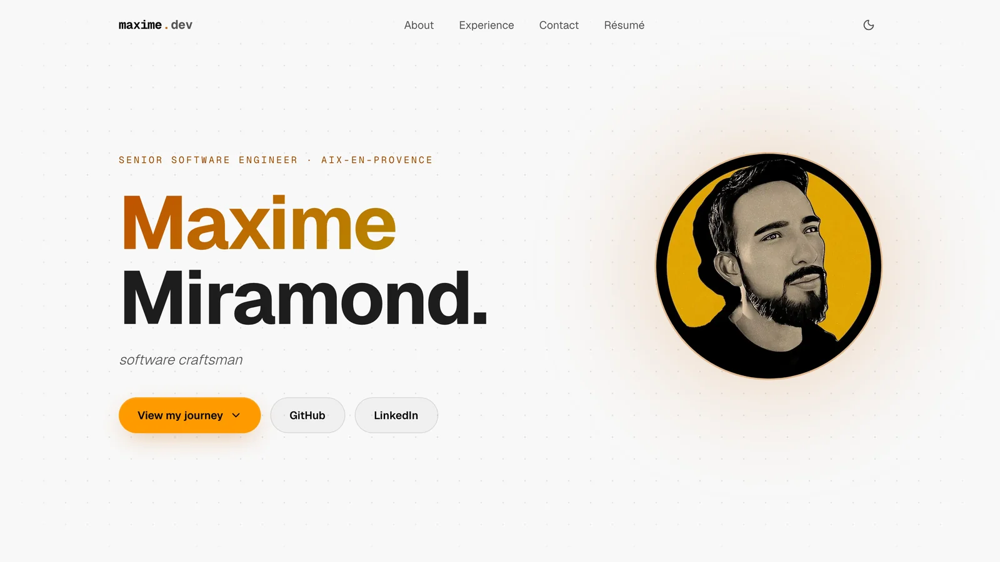
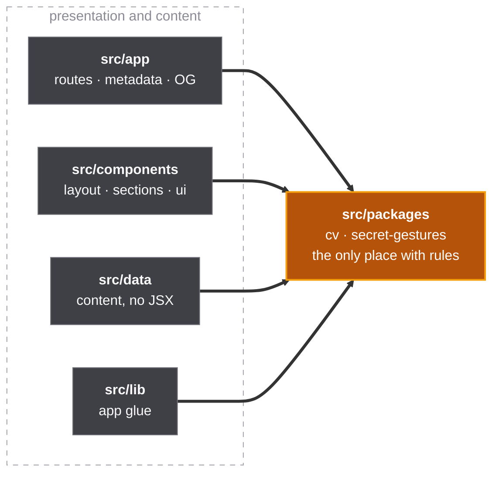

<p align="center">
  
</p>

<p align="center">
  
  
  
  
  
  
</p>

<p align="center">
  <i>A personal portfolio. Because apparently LinkedIn isn't enough anymore.</i>
</p>

<p align="center">
  <a href="https://maximemiramond.com"><b>maximemiramond.com</b></a>
</p>

<p align="center">
  <picture>
    <source media="(prefers-color-scheme: dark)" srcset="https://raw.githubusercontent.com/miramo/portfolio/main/.github/readme/home-dark.webp" />
    
  </picture>
</p>

A one-page portfolio with a résumé that prints on a single A4 sheet, even from a phone. Light and
dark themes without the flash, and motion that steps aside when your OS asks it to. There is also an
easter egg. Gamers of a certain age will find it.

---

## Where to look

Two minutes to spare? Start here.

- [`src/packages/cv`](./src/packages/cv): the dates. A role that ends before it starts doesn't
  build, so the CV can't publish one.
- [`src/components/ui/arcade-mode.tsx`](./src/components/ui/arcade-mode.tsx): the easter egg,
  as one pure reducer. Spoilers, obviously.
- [`src/packages/cv/index.test.ts`](./src/packages/cv/index.test.ts) and [`e2e/`](./e2e): tests
  written to be read as a spec.

## Architecture



Dependencies point inward, and `pnpm lint:boundaries` fails CI the day one doesn't. Architecture
diagrams should be executable, not aspirational.

No ports, no adapters, no repositories: it's a static site whose database is a TypeScript array.
There is nothing to decouple from, and a hexagon with one side is just a line.

## Decisions

Only the domain gets unit tests, and Stryker makes sure they would actually catch something.
Components get none: testing that the markup is the markup is not testing. Playwright covers them
on the built site, desktop and phone.

axe checks accessibility on both pages, in both themes. If it complains, the pull request stays red.

Still on TypeScript 6. Version 7 is faster, but typescript-eslint doesn't speak it yet.

## Built with an agent

I write this code with a coding agent. It follows [`AGENTS.md`](./AGENTS.md) and the rules in
[`.claude/rules/`](./.claude/rules), and nothing lands unless `pnpm verify` passes. The agent types
fast. The chain decides what stays.

## Commands

```bash
pnpm dev        # → http://localhost:3000
pnpm build      # → out/  (static, deploy anywhere)
pnpm verify     # the whole chain: lint, format, boundaries, unused code, types, unit, mutation, browser, a11y
pnpm lint:fix   # because the linter is always right
```

CI runs the same chain minus mutation testing, which has its own weekly workflow.

## License

The code is [MIT](./LICENSE). The content is not: the texts, the résumé and the avatar are mine,
all rights reserved. Fork the code, not the face.
